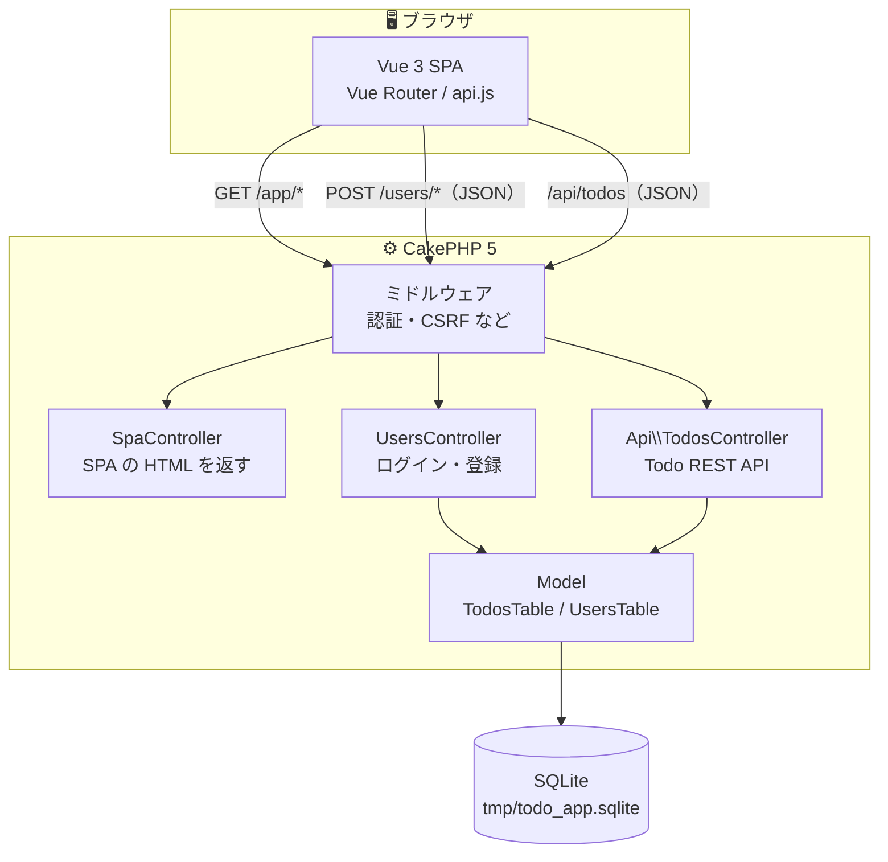
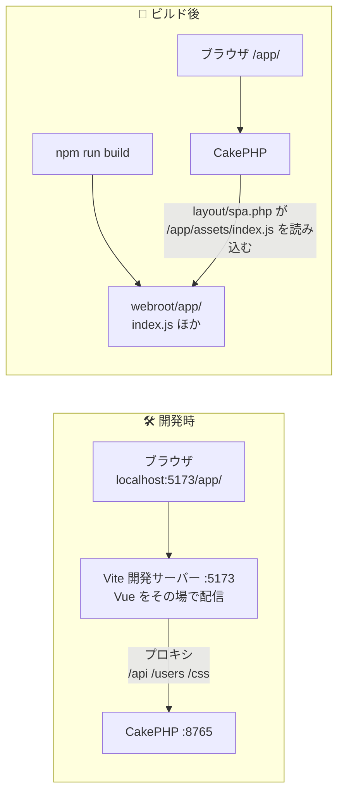
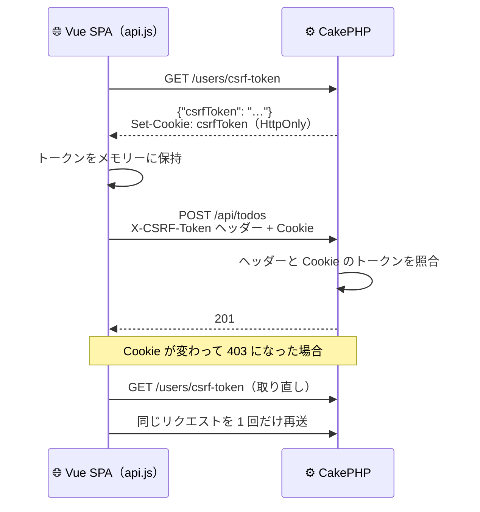
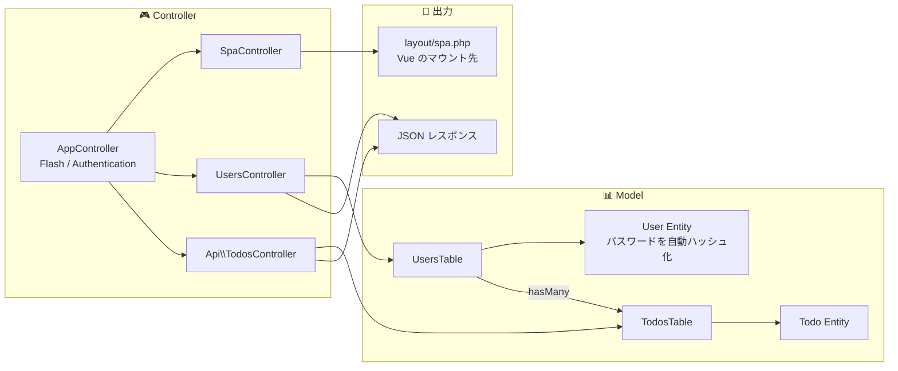
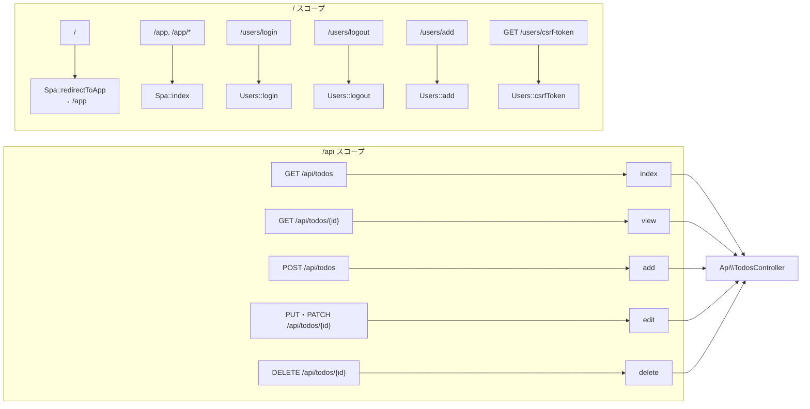
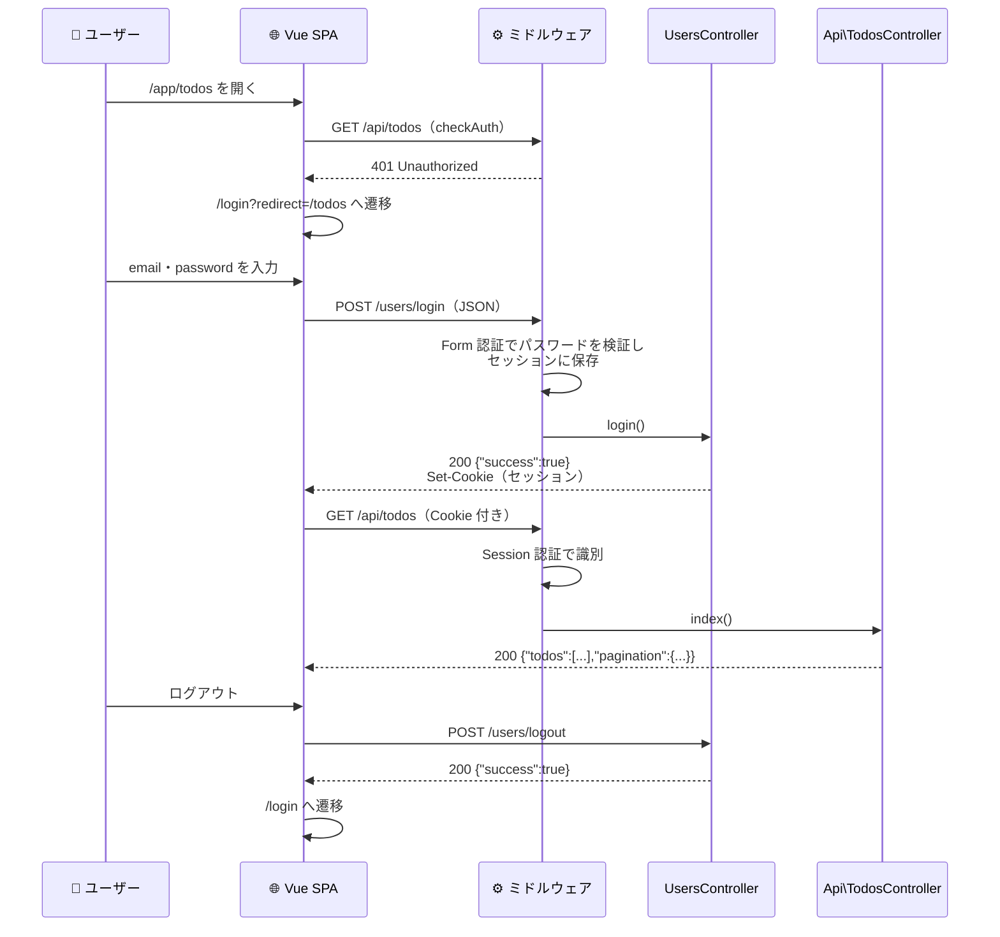
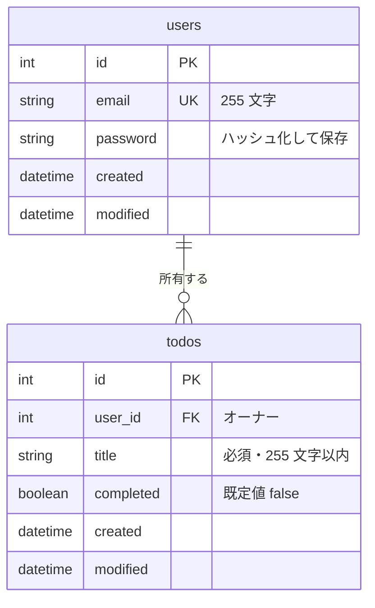
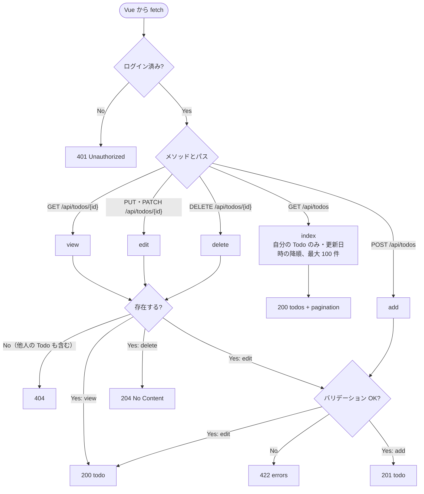
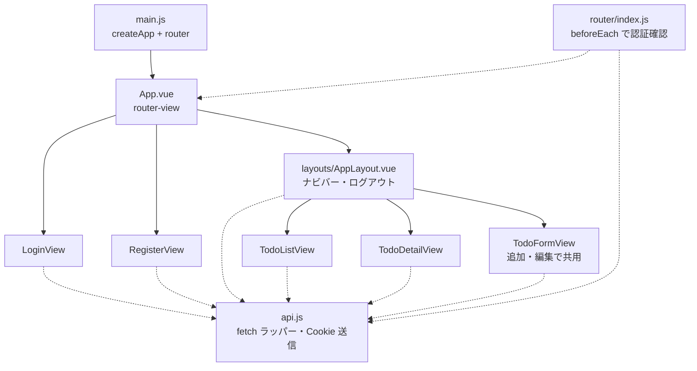

# Todo App アーキテクチャ構成図

CakePHP 5（JSON API・認証）と Vue 3（SPA）で構成した Todo アプリケーションの構成図です。

---

## 1. 全体アーキテクチャ

ブラウザ上の Vue SPA が画面を描画し、CakePHP の JSON API を `fetch` で呼び出します。ログイン状態は CakePHP のセッション Cookie で保持します。



---

## 2. 開発時と本番時の配信



| 項目 | 開発時 | ビルド後 |
|---|---|---|
| 入口 URL | `http://localhost:5173/app/` | `http://<host>/app/` |
| Vue の配信元 | Vite 開発サーバー | `webroot/app/`（CakePHP が配信） |
| API の宛先 | Vite が CakePHP（8765）へプロキシ | 同じオリジンの CakePHP |
| 設定ファイル | `frontend/vite.config.js` | `frontend/vite.config.js`（`build.outDir`） |

---

## 3. ミドルウェア層

すべてのリクエストは `src/Application.php` の `middleware()` に並べた順に通過します。

```mermaid
flowchart LR
    Req([リクエスト]) --> E["ErrorHandler<br/>例外をエラー応答に変換"]
    E --> H["HostHeader<br/>本番時のみ Host を検証"]
    H --> A["Asset<br/>プラグインの静的ファイル"]
    A --> R["Routing<br/>URL → コントローラー"]
    R --> BP["BodyParser<br/>JSON ボディを解析"]
    BP --> C["CSRF<br/>POST/PUT/PATCH/DELETE は<br/>トークン必須"]
    C --> LT["LoginThrottle<br/>ログイン失敗が多いと 429"]
    LT --> Au["Authentication<br/>セッション / フォーム認証"]
    Au --> AU["ApiUnauthorized<br/>/api 未認証なら 401 JSON"]
    AU --> Ctrl([コントローラー])
```



- `ApiUnauthorizedMiddleware`（`src/Middleware/`）: `/api` で始まるパスに未認証でアクセスされた場合、ログイン画面へリダイレクトせずに `401 {"error":"Unauthorized"}` を返します。SPA はこれを見てログイン画面へ遷移します。
- CSRF: 状態を変えるリクエスト（POST / PUT / PATCH / DELETE）はすべて、例外なくトークンを検証します。認証より前に置いているので、ログインのリクエストも、ログインが成立する前に検証されます（ログイン CSRF 対策）。

- `LoginThrottleMiddleware`（`src/Middleware/`）: `POST /users/login` の失敗（401）を数えます。15 分間に「同じ IP + 同じメールアドレス」で 5 回、または「同じ IP」で 20 回失敗すると、`429` と `Retry-After` ヘッダーを返します。上限中はパスワードの照合まで進みません。ログインに成功すると「IP + メールアドレス」のカウントは 0 に戻ります。

### CSRF トークンの受け渡し



他のサイトの JavaScript は、CORS の制限で `/users/csrf-token` のレスポンスを読めず、`X-CSRF-Token` のような独自ヘッダーも付けられません。そのため、他のサイトからのリクエストは 403 で拒否されます。

---

## 4. バックエンド MVC 構造



画面はすべて Vue SPA が描画します。サーバー側は SPA の土台となる HTML（`layout/spa.php`）と JSON だけを返します。`UsersController` をブラウザで直接開いた（GET した）場合は、SPA の画面（`/app/login`、`/app/register`）へリダイレクトします。

---

## 5. ルーティング

### サーバー側（`config/routes.php`）



ここに定義したルート以外は 404 になります（`fallbacks()` は使っていません）。

### クライアント側（`frontend/src/router/index.js`、ベース `/app/`）

| パス | 画面コンポーネント | 認証 |
|---|---|---|
| `/login` | `LoginView` | 不要 |
| `/register` | `RegisterView` | 不要 |
| `/todos` | `TodoListView` | 必要 |
| `/todos/new` | `TodoFormView`（mode: add） | 必要 |
| `/todos/:id` | `TodoDetailView` | 必要 |
| `/todos/:id/edit` | `TodoFormView`（mode: edit） | 必要 |

認証が必要な画面は `AppLayout`（ナビバー・ログアウトボタン）の子ルートです。

---

## 6. 認証フロー



- 画面遷移のたびに、ルーターの `beforeEach` が `checkAuth()`（`GET /api/todos` が成功するか）で認証状態を確かめます。
- 認証方式は `Application::getAuthenticationService()` で設定しています（Session 認証と、email・password による Form 認証）。

### Cookie の設定

| Cookie | 用途 | 属性 |
|---|---|---|
| `TODOAPP_SESSION` | ログイン状態（セッション ID） | HttpOnly、SameSite=Lax、本番では Secure |
| `csrfToken` | CSRF トークンの照合用 | HttpOnly、SameSite=Lax、本番では Secure |

- `Secure` 属性（HTTPS でのみ送信）は、環境変数 `COOKIE_SECURE` で指定します。指定がなければ、本番（`DEBUG=false`）では付け、開発（HTTP）では付けません（`config/bootstrap.php`）。
- サーバーが発行していないセッション ID は受け付けません（`session.use_strict_mode`）。ログインとログアウトのときには、セッション ID を作り直します。どちらもセッション固定攻撃への対策です。
- 操作がないまま `SESSION_TIMEOUT` 分（既定 120 分）たつと、セッションは切れます。

---

## 7. データベーススキーマ

SQLite（`tmp/todo_app.sqlite`）を使用します。テーブルは `config/Migrations/` のマイグレーションで作成します。



- Todo は必ず 1 人のユーザーが所有します（`todos.user_id` は NOT NULL、外部キー制約付き）。
- ユーザーを削除すると、そのユーザーの Todo も削除されます（`ON DELETE CASCADE`、`UsersTable` の `dependent`）。
- API はログイン中のユーザーが所有する Todo だけを扱います。他人の Todo の ID を指定した場合は、存在を明かさないように 404 を返します。

---

## 8. リクエスト処理フロー（Todo CRUD API）



---

## 9. フロントエンド構成



スタイルは Tailwind CSS 4 を使用しています。

- Vue 側: `frontend/src/style.css` を `@tailwindcss/vite` でビルド
- PHP テンプレート側（SPA レイアウト）: `css/input.css` を Tailwind CLI でビルドし、`webroot/css/tailwind.css` に出力（ルートの `npm run build`）

---

## 10. ディレクトリ構成

```
todo_app/
├── src/                      # バックエンド (CakePHP)
│   ├── Application.php       # ミドルウェア・認証の設定
│   ├── Controller/           # Spa / Users / Api\Todos / Error
│   ├── Middleware/           # ApiUnauthorized / HostHeader
│   └── Model/                # Table (検証ルール) と Entity
├── config/
│   ├── routes.php            # サーバー側ルーティング
│   ├── app.php               # アプリ共通設定
│   ├── app_local.php         # 環境ごとの設定・秘密情報 (Git 管理外、example から生成)
│   └── Migrations/           # CreateTodos, CreateUsers, AddUserIdToTodos
├── templates/
│   ├── layout/spa.php        # SPA のレイアウト
│   └── Error/                # エラー画面
├── frontend/                 # フロントエンド (Vue 3 + Vite)
│   ├── src/                  # main.js, App.vue, api.js, router/, layouts/, views/
│   └── vite.config.js        # base: /app/、ビルド出力先、開発用プロキシ
├── webroot/
│   ├── app/                  # Vue のビルド成果物
│   └── css/tailwind.css      # PHP テンプレート用 CSS
├── css/input.css             # tailwind.css の元ファイル
├── tests/                    # PHPUnit (テスト DB: tmp/tests.sqlite)
└── tmp/todo_app.sqlite       # 開発用 DB (Git 管理外)
```

---

## 概要まとめ

| 項目 | 内容 |
|------|------|
| バックエンド | CakePHP 5.3（PHP 8.2+）、JSON API |
| フロントエンド | Vue 3 + Vue Router（SPA）、Vite |
| スタイル | Tailwind CSS 4 |
| 認証 | cakephp/authentication（Session + Form、セッション Cookie） |
| データベース | SQLite |
| 主なテーブル | users, todos |

### 認証不要のアクション
- `SpaController::index` / `redirectToApp` - SPA の配信、`/` から `/app` へのリダイレクト
- `UsersController::login` - ログイン
- `UsersController::add` - ユーザー登録
- `UsersController::csrfToken` - CSRF トークン取得
- `UsersController::logout` - ログアウト（未ログインでも成功扱い）

### 認証必須のアクション
- `Api\TodosController` の全アクション（未認証時は 401 JSON。ログイン中のユーザーが所有する Todo のみ操作可能）
