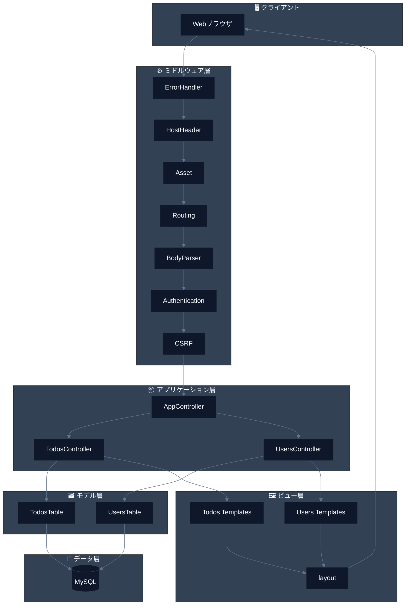
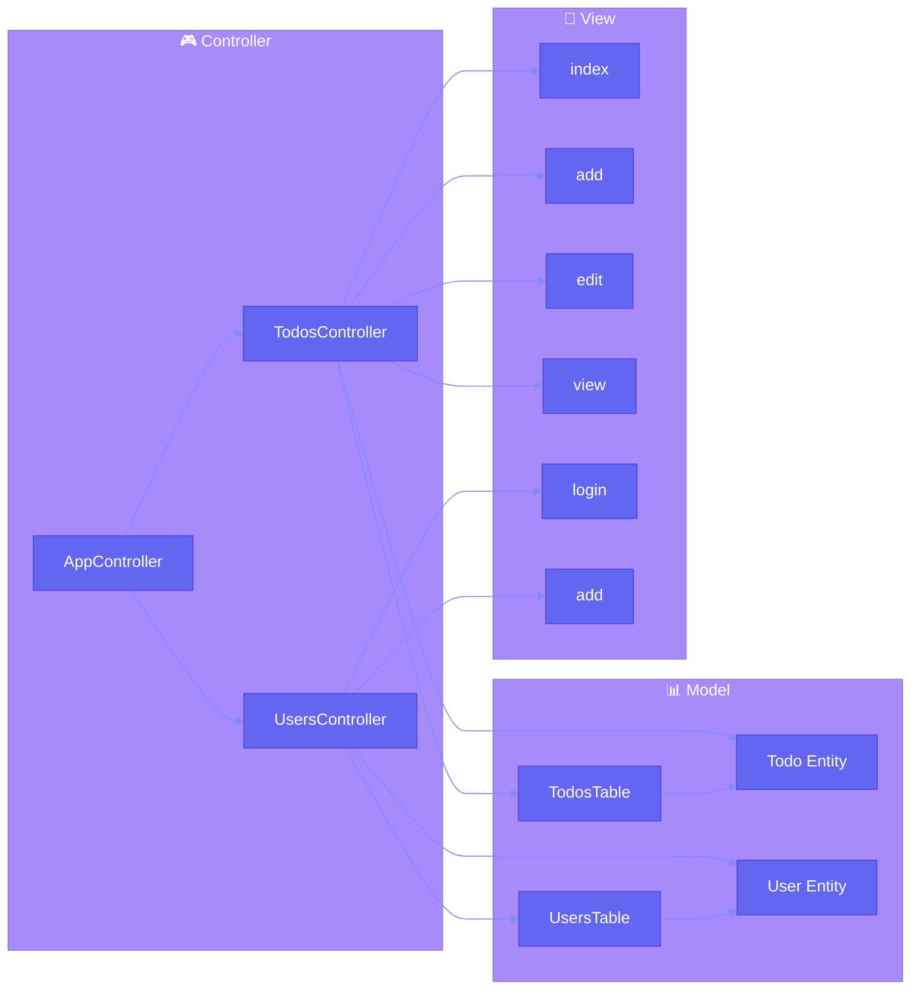
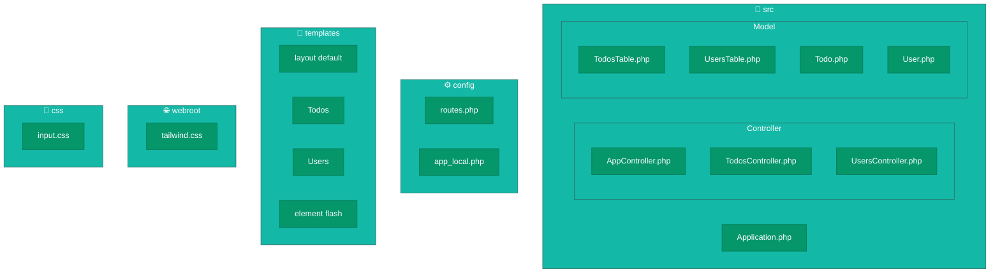
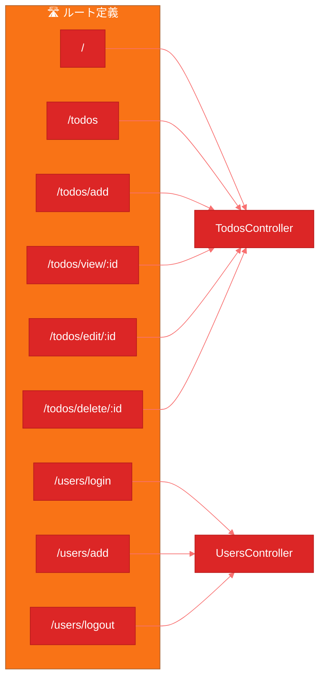
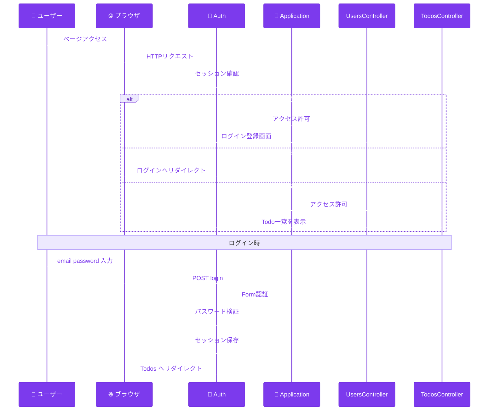
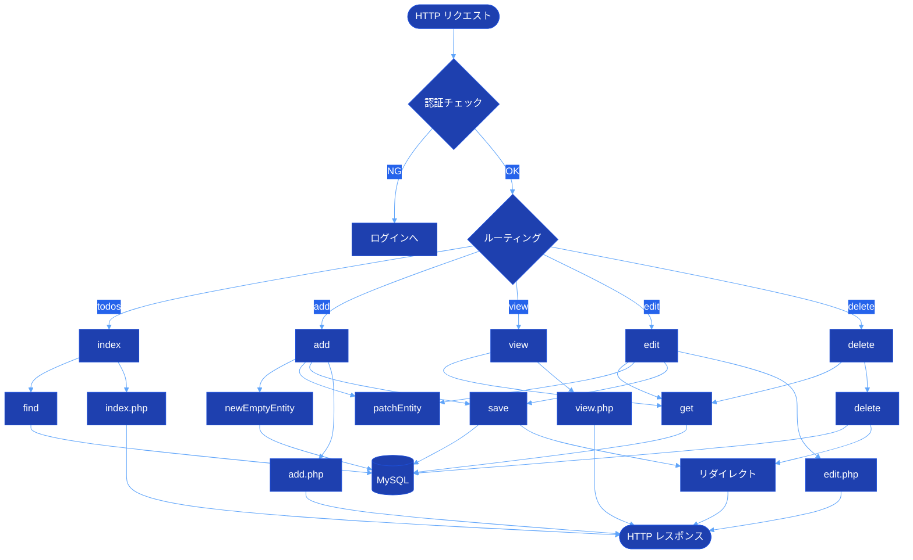
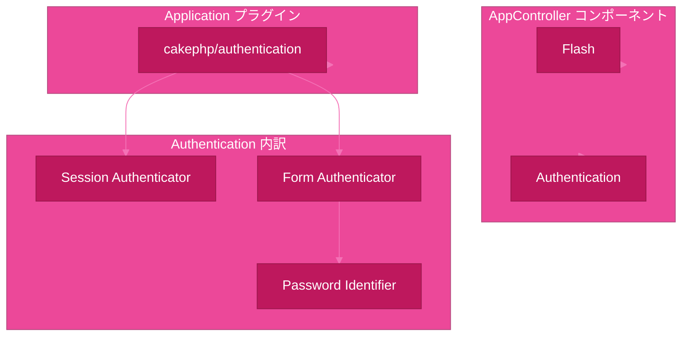
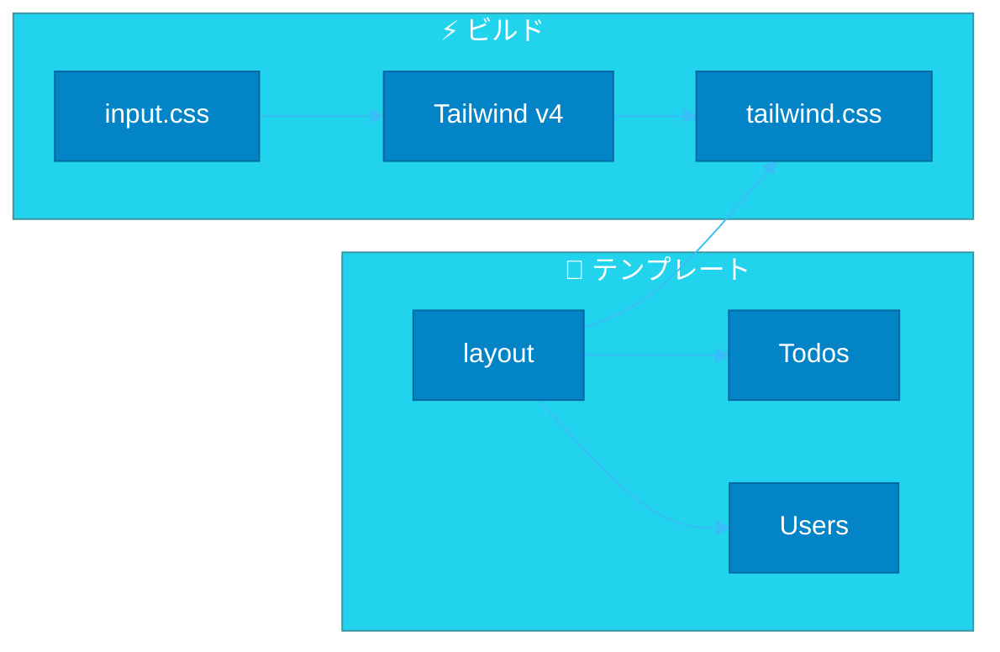

# Todo App アーキテクチャ構成図

CakePHP 5 と Authentication プラグインを使用した TODO アプリケーションの構成図です。

---

## 1. 全体アーキテクチャ



---

## 2. MVC 構造



---

## 3. ディレクトリ構成



---

## 4. ルーティング



---

## 5. 認証フロー



---

## 6. データベーススキーマ

```mermaid
%%{init: {'theme':'base', 'themeVariables': { 'primaryColor':'#0e7490', 'primaryTextColor':'#fff', 'primaryBorderColor':'#0d9488', 'lineColor':'#22d3ee', 'secondaryColor':'#0891b2', 'secondaryTextColor':'#fff', 'tertiaryColor':'#06b6d4', 'tertiaryTextColor':'#fff', 'background':'#ecfeff', 'mainBkg':'#0e7490', 'secondBkg':'#0891b2', 'tertiaryBkg':'#06b6d4', 'fontFamily':'system-ui, sans-serif'}}}%%
erDiagram
    users {
        int id PK
        string email UK
        string password
        datetime created
        datetime modified
    }

    todos {
        int id PK
        string title
        boolean completed
        datetime created
        datetime modified
    }

    note right of users : users と todos は現時点で関連なし
```

---

## 7. リクエスト処理フロー（Todo CRUD）



---

## 8. コンポーネント・プラグイン



---

## 9. フロントエンド構成



---

## 概要まとめ

| 項目 | 内容 |
|------|------|
| フレームワーク | CakePHP 5.x |
| 認証 | cakephp/authentication プラグイン |
| データベース | MySQL |
| フロントエンド | Tailwind CSS v4 |
| 主なテーブル | users, todos |

### 認証不要のアクション
- `UsersController::login` - ログイン
- `UsersController::add` - ユーザー登録
- `UsersController::dbTest` - DB接続テスト

### 認証必須のアクション
- `TodosController` の全アクション（index, view, add, edit, delete）
- `UsersController::logout` - ログアウト
